<div align="center">

<picture>
  <source media="(prefers-color-scheme: dark)" srcset="docs/banner-dark.svg" />
  
</picture>

**Stella**（拉丁语「星」）—— 与背后的协议库 **Astral** 是一对星名。本仓库不包含任何后端内容。

[](LICENSE)
[](https://react.dev)
[](https://mui.com)
[](https://vite.dev)

</div>

---

> [!WARNING]
> 本项目仅供**学习与协议研究**使用。所有写操作都会真实修改服务器数据且**不可撤销**。
> 请遵守游戏服务条款，不要用于破坏游戏公平性。

## 这是什么

Stella 是一个跑在浏览器里的操作台。协议组包和发送由独立的 Astral 完成，
而**流程怎么走、参数怎么算、进度怎么看，全部由 Stella 决定**。

## Stella 做了什么

### 界面

- 十个功能页面：主页、扫码登录、机台预设、上传成绩、版本预设、解锁歌曲、收藏品、功能票、数据快照、转生工具
- 扫屏登录：框选屏幕上的二维码区域自动识别，不依赖手机摄像头
- 上传表单分「简易 / 高级」两层，共享同一份状态，切换不丢数据
- 深浅双主题，遵循 MUI 自身的 Material Design 规范

### 本地计算

- **判定推导** —— 达成率、AP 徽章、DX 星由同一份判定分布算出，三个数字永远不会互相矛盾
- **内置版本曲库** —— 20 个版本的 5500+ 张谱面物量随前端发布，批量上传不依赖任何在线数据源
- **随机策略** —— 达成率与 DX 星在指定区间内随机，预览时固定，上传途中不再变化

### 流程编排

- **批量上传** —— 自动分批（每局最多 4 首）、跳过已有更好成绩、逐局续关并衔接新登录
- **延迟回查** —— 不信任「上传成功」：下一局开始后再逐首核对上一局的 `musicId + level`
- **跨设备进度** —— 任务进度上报后端，手机打开任意页面即可看到当前批次与完成数

### 工程细节

- **后端可替换** —— 只依赖一组 HTTP 契约，任何语言实现同一契约即可驱动整个界面；自带零依赖 Node mock
- **字体按需子集** —— 构建时扫描源码用字，中文界面字体切成 75 个分块共约 230 KB
- **后端地址四级解析** —— URL 参数 > localStorage > 构建变量 > 同源 `/api`

## 快速开始

```bash
npm install
npm run dev -- --host 127.0.0.1 --port 5173 --strictPort
```

生产构建：

```bash
npm run build
```

没有真实后端时，可以 `npm run mock` 启动零依赖 mock 开发界面。

## 免责声明

Stella 只是 Web 控制台，不是游戏官方软件，也与游戏开发商、运营方、Astral 及其作者没有任何合作、授权或背书关系。通过它调用外部组件可能真实修改账号数据，并导致成绩异常、数据覆盖或账号封禁等后果，请自行评估并承担全部风险。
